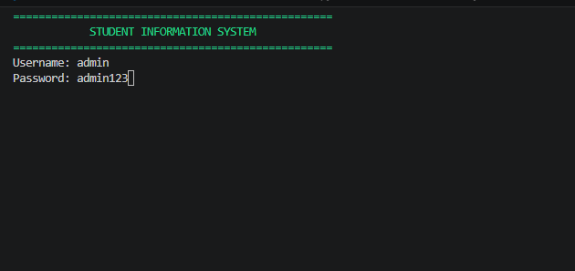
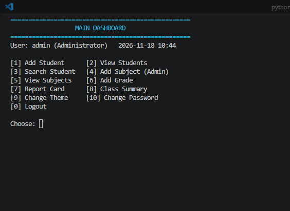

# Student Information System

A terminal-based Student Information System built with Python 3 and text file (.txt) storage.

## Features
- Login and logout (Administrator and Staff roles) with salted password hashing
- Add, view, and search student records
- Add and view subjects
- Add grades
- Reports: student report card and class summary
- Two color themes
- Change password
- Data saved in text files

## Requirements
- Python 3

## How to Run
1. Download or clone this repository
2. Open the folder in a terminal
3. Run: python main.py

## Sample Login
- Admin: admin / admin123
- Staff: staff / staff123

## Files
- main.py
- users.txt
- students.txt
- subjects.txt
- grades.txt

## Author
Banua, Shekyla S.
BSCS 2nd Year-A

## Acknowledgement 
Dela Crus, Wella Mae 
BSCS 2nd Year-A

## Screenshots

### Login

### Main Dashboard

### Add Student

### View Subjects

### Add Grade

### Student Report Card

### Class Summary

### Theme Customization
